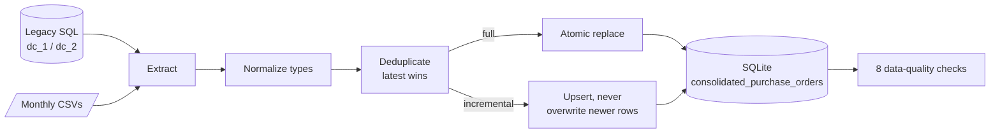
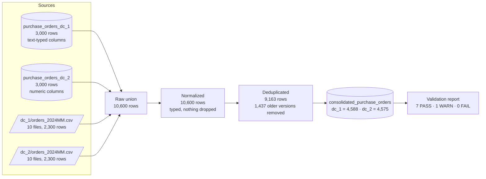
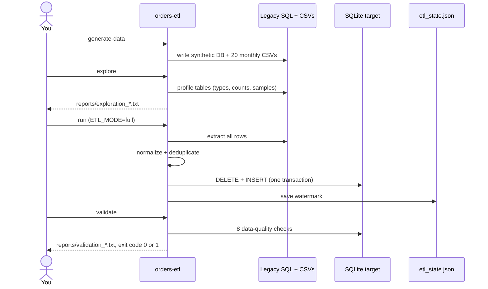
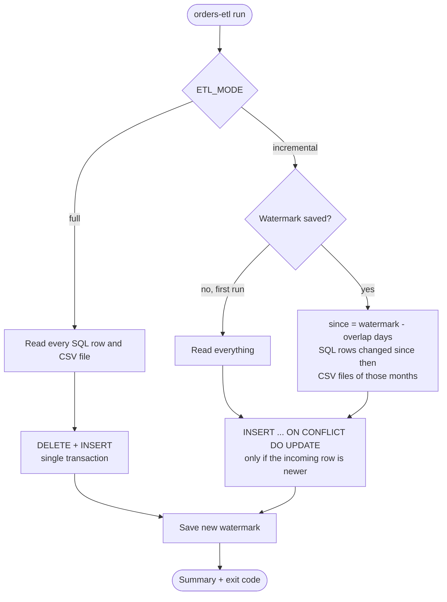
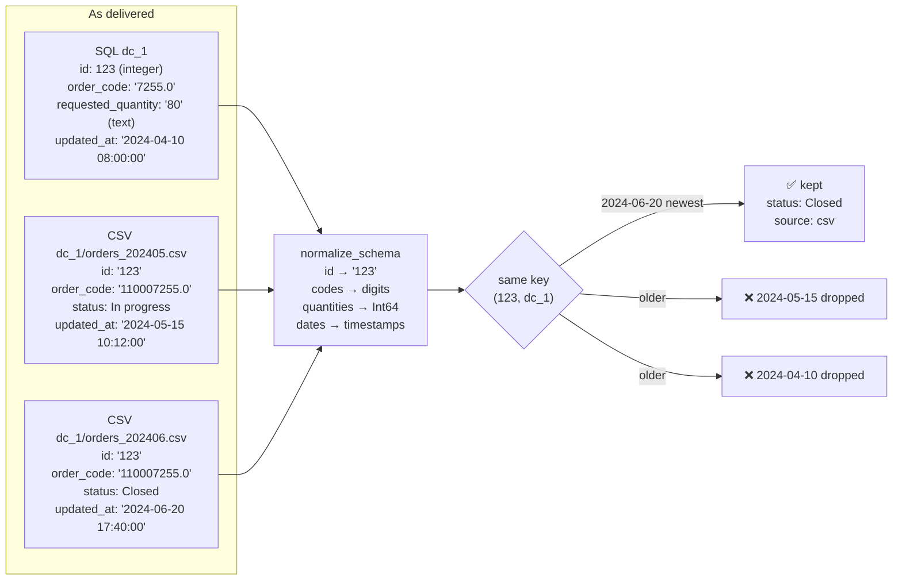

# multi-source-orders-etl

[](https://github.com/benedetto597/multi-source-orders-etl/actions/workflows/ci.yml)

[](LICENSE)

A Python ETL that consolidates purchase orders from **two distribution centers**. The orders arrive through **a legacy SQL database with schema drift** and **monthly CSV drops**, and the pipeline turns them into a single **deduplicated, validated** table. It supports both full-refresh and incremental (watermark + upsert) loads.

> Built from a data-engineering take-home assignment I completed, then hardened for this portfolio. All data in this repository is **synthetic**, produced by a deterministic generator that reproduces the original problem.

## The challenge

- Each distribution center stores the same order entity in its own SQL table, with **inconsistent types**. One center keeps codes, quantities and dates as text, while the other uses numeric types and leaves `updated_at` NULL for some rows.
- Monthly CSV files for March–December 2024 **re-deliver many of those orders with a newer state**, so one order can appear several times across sources.
- Goal: one table with exactly one row per order (`id` + distribution center), keeping **the most recent version**, with lineage and data-quality checks.

## How it works



| Step | What happens |
|---|---|
| **Extract** | Any SQLAlchemy URL (SQLite for the demo, SQL Server via `pyodbc` in real use) plus CSV folders per distribution center. Incremental runs read only rows changed since the last watermark. |
| **Normalize** | `11944.0` → `"11944"`, `"110012913.0"` → `"110012913"`, text quantities → integers, mixed date formats → timestamps. Unparseable values become NULL, and the row is kept for validation. |
| **Deduplicate** | Key `(id, distribution_center)`. Rows are ranked by `updated_at`, falling back to `created_at`. Undated rows lose, and on ties the later delivery wins. |
| **Load** | Full refresh: `DELETE` + `INSERT` in **one transaction**, so a failed run never leaves the table half-empty. Incremental: `INSERT … ON CONFLICT DO UPDATE … WHERE newer`. |
| **Validate** | Table exists, row count, duplicate keys, critical NULLs, known centers and statuses, date range, numeric consistency. Results are PASS / WARN / FAIL with a saved report. |

More detail: [docs/architecture.md](docs/architecture.md) · How I'd scale it into a platform: [docs/design-notes.md](docs/design-notes.md)

## Diagrams

GitHub renders these Mermaid diagrams natively, and you can zoom and pan them.

### Data flow, with real volumes

Numbers come from the default synthetic dataset (see [sample output](#quickstart)).



### Workflow: one CLI command at a time



### Full refresh vs incremental



### Example: one order, three deliveries

The same order `id = 123` of distribution center 1 arrives in three shapes. Normalization makes them comparable, and deduplication keeps the newest.



Edge cases handled by the same rule:

| Situation | Result |
|---|---|
| `updated_at` is NULL or `"N/A"` | falls back to `created_at` |
| no usable date at all | loses to any dated version |
| identical timestamps | the later delivery (CSV) wins |
| same `id` in `dc_1` and `dc_2` | two different orders, both kept |
| incremental run re-reads an older version | the upsert guard skips it (`skipped_stale`) |

## Key design decisions

- **Business key = `(id, distribution_center)`**: the same `id` exists in both centers and refers to different orders.
- **Latest wins, everywhere**: the same rule applies inside a batch (dedup) and against the target (upsert guard), so re-reading data is always safe.
- **Full refresh by default**: simple and fully consistent at this volume. The incremental mode exists for frequent runs, re-reading an overlap window before the watermark to catch late updates.
- **Keep bad rows, flag them**: type coercion never drops data silently. The validator reports what looks wrong.
- **Secrets only in the environment**: configuration comes from env vars or `.env`, and `.env.example` documents them.

## Quickstart

```bash
git clone https://github.com/benedetto597/multi-source-orders-etl.git
cd multi-source-orders-etl
python -m venv .venv
source .venv/bin/activate          # Windows: .venv\Scripts\activate
pip install -e ".[dev]"

orders-etl generate-data           # synthetic legacy DB + 20 monthly CSVs under data/
orders-etl explore                 # profile the source (types, counts, samples)
orders-etl all                     # run the ETL, then validate
```

Sample output (default synthetic dataset, 3,000 SQL orders per center):

```text
ETL finished (full) in 0.84s
  extracted rows        : 10,600
  duplicates removed    : 1,437
  rows in target        : 9,163
  duplicate keys        : 0
  by distribution center: dc_1=4,588, dc_2=4,575
  by source             : csv=4,438, sql_dc_1=2,370, sql_dc_2=2,355

Checks: 8 | Passed: 7 | Warnings: 1 | Failed: 0 | Errors: 0
1. [PASS] Table exists - found
2. [PASS] Row count - 9,163 rows
3. [PASS] Duplicate keys - 0 duplicate keys
4. [PASS] Critical nulls - no nulls in key columns
5. [PASS] Distribution centers - ['dc_1', 'dc_2']
6. [PASS] Valid statuses - 7 statuses
7. [PASS] Date range - created_at 2023-01-02 00:10:36 .. 2024-12-31 09:34:50
8. [WARN] Numeric consistency - 252 rows with received_quantity > requested_quantity
RESULT: PASSED WITH WARNINGS
```

Incremental run:

```bash
ETL_MODE=incremental orders-etl run    # PowerShell: $env:ETL_MODE="incremental"; orders-etl run
```

## Configuration

Copy `.env.example` to `.env` and adjust as needed:

| Variable | Default | Purpose |
|---|---|---|
| `SOURCE_DB_URL` | `sqlite:///data/source/legacy_source.db` | Source database (any SQLAlchemy URL) |
| `CSV_DIR` | `data/csv` | One sub-folder per center with `orders_YYYYMM.csv` |
| `TARGET_DB_PATH` | `data/target/warehouse.db` | Target SQLite database |
| `REPORTS_DIR` | `reports` | Exploration and validation reports |
| `ETL_MODE` | `full` | `full` or `incremental` |
| `INCREMENTAL_OVERLAP_DAYS` | `30` | Re-read window before the watermark |
| `ETL_STATE_PATH` | `data/target/etl_state.json` | Watermark file |

To read from SQL Server, install the extra with `pip install -e ".[mssql]"`, install ODBC Driver 18, and set `SOURCE_DB_URL` to a `mssql+pyodbc://…` URL.

## Testing

```bash
pytest --cov=orders_etl     # 66 tests, ~98% coverage
ruff check . && ruff format --check .
```

The tests cover type normalization edge cases, dedup tie-breaking, transactional rollback, upsert stats and the stale-row guard, incremental runs, CLI exit codes, and an end-to-end run on synthetic data. CI runs them on Python 3.11–3.13, together with a smoke run of the CLI and a [gitleaks](https://github.com/gitleaks/gitleaks) secret scan.

## Project layout

```text
src/orders_etl/
  config.py      settings from env / .env
  schema.py      table names, columns, DDL (single source of truth)
  extract.py     SQL + CSV extractors
  transform.py   type normalization
  dedup.py       latest-wins deduplication
  load.py        atomic full refresh + guarded upsert
  validate.py    data-quality checks and report
  explore.py     source profiling
  pipeline.py    orchestration
  cli.py         `orders-etl` command
  synthetic.py   deterministic test-data generator
tests/           pytest suite
docs/            architecture and design notes
```

## What I'd do next

- Add a CI job that runs against SQL Server in a container.
- Schedule with Airflow/Prefect, with retries and alerting.
- Write the target as Parquet/Delta, and use CDC on the source instead of a timestamp watermark.

## History

The first commit holds the original submission (phase-by-phase scripts, with credentials removed). Later commits refactor it into this package.

## License

[MIT](LICENSE) © 2026 Edgar Benedetto
