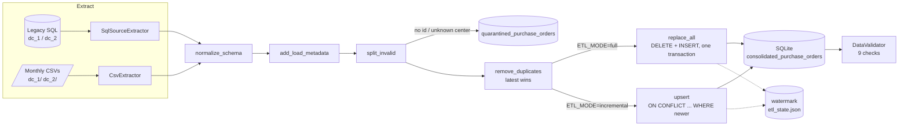

# Architecture

## Sources

| Source | Content | Quirks |
|---|---|---|
| `purchase_orders_dc_1` (legacy SQL) | Historical orders of distribution center 1 | `order_code`, `requested_quantity` and dates stored as text, `product_code` as float, occasional unparseable dates |
| `purchase_orders_dc_2` (legacy SQL) | Historical orders of distribution center 2 | `id` stored as text, proper numeric types, `updated_at` sometimes NULL |
| `csv/dc_{1,2}/orders_YYYYMM.csv` | Monthly drops, March–December 2024 | Everything is text, `order_code` looks like `110012913.0`, an extra `update_month` column, many orders re-delivered with a newer state |

The business key of an order is **`(id, distribution_center)`**: the same `id` can exist in both centers and refer to different orders.

## Pipeline

| Module | Responsibility |
|---|---|
| `config.py` | Settings from environment variables / `.env` |
| `schema.py` | Table names, target columns, DDL and indexes (single source of truth) |
| `extract.py` | SQL extraction through any SQLAlchemy URL; CSV extraction by distribution-center folder |
| `transform.py` | Casts every source to the target types; bad values become NULL, the row is kept |
| `quarantine.py` | Sets aside rows with no `id` or an unattributable center, with a reason |
| `dedup.py` | One row per key, the most recent one |
| `load.py` | Atomic full refresh, latest-wins upsert, load summary |
| `validate.py` | Post-load data-quality checks and report |
| `explore.py` | Source profiling (types, counts, samples, date ranges, duplicate ids) |
| `pipeline.py` / `cli.py` | Orchestration and command line |
| `synthetic.py` | Deterministic data generator that reproduces the original problem |

## Unified schema — `consolidated_purchase_orders`

| Column | Type | Notes |
|---|---|---|
| `id` | TEXT | part of the primary key; normalized (`11944.0` → `11944`) |
| `distribution_center` | TEXT | part of the primary key; `dc_1` / `dc_2` (added by the ETL) |
| `order_code` | TEXT | normalized digits or NULL |
| `product_code` | INTEGER | nullable (no fake `0`) |
| `status` | TEXT | Closed, In progress, Cancelled, Confirmed, Shipped, Invoiced, Partially received |
| `received_quantity` / `requested_quantity` | INTEGER | |
| `total` | REAL | |
| `created_at` / `updated_at` | TIMESTAMP | stored as `YYYY-MM-DD HH:MM:SS` text |
| `supplier_code` | TEXT | |
| `update_month` | TEXT | only present in CSV deliveries |
| `source` | TEXT | lineage: `sql_dc_1`, `sql_dc_2`, `csv` |
| `loaded_at` | TIMESTAMP | first time the row was loaded |
| `modified_at` | TIMESTAMP | last time the row changed |

Indexes: `distribution_center`, `created_at`, `updated_at`, `status`, `order_code`.

## Quarantine

A row whose business key is unusable (no `id`, or a CSV order code that cannot be attributed to a distribution center) cannot be deduplicated or loaded. Instead of failing the whole run, `split_invalid` moves it to `quarantined_purchase_orders`, which has the same columns as the target plus `quarantine_reason`. A full refresh replaces the quarantine table; incremental runs append to it. The validation report shows the count by reason, so someone can review and fix the source.

## Deduplication

1. Key: `(id, distribution_center)`.
2. Reference date: `updated_at`, falling back to `created_at` when `updated_at` is NULL or unparseable.
3. Keep the most recent row; rows with no usable date lose to any dated row.
4. Exact tie: the row delivered later wins (CSV drops are newer than the SQL snapshot).

| id | distribution_center | updated_at | |
|---|---|---|---|
| 123 | dc_1 | 2024-05-15 | dropped |
| 123 | dc_1 | 2024-06-20 | **kept** |
| 123 | dc_1 | 2024-04-10 | dropped |

## Full refresh vs incremental

| | Full refresh (`ETL_MODE=full`, default) | Incremental (`ETL_MODE=incremental`) |
|---|---|---|
| Reads | everything | rows changed since `watermark - INCREMENTAL_OVERLAP_DAYS`, CSVs of those months |
| Writes | `DELETE` + `INSERT` in a single transaction | `INSERT … ON CONFLICT DO UPDATE … WHERE newer` |
| Failure | old data stays intact (rollback) | partial batch rolled back |
| Use when | first load, small tables, unpredictable changes | frequent runs, large tables, only recent rows change |

The overlap window re-reads a margin before the watermark to catch late-arriving updates; the latest-wins guard makes re-reading safe.

## Validation

| # | Check | Fails as |
|---|---|---|
| 1 | Target table exists | FAIL (stops) |
| 2 | Row count within expectations | WARN |
| 3 | No duplicate keys | FAIL |
| 4 | No NULL `id` / `distribution_center` / `source` | FAIL |
| 5 | Only known distribution centers (missing ones warn) | FAIL / WARN |
| 6 | Only known statuses | WARN |
| 7 | `created_at` within the expected range | WARN |
| 8 | No negative quantities/totals; flag over-deliveries | FAIL / WARN |
| 9 | Rows set aside in `quarantined_purchase_orders` (counted by reason) | WARN |

## Scaling path

- **Volume:** read in chunks or switch the engine to Polars/DuckDB; move the target to Parquet/Delta.
- **Recurrence:** schedule with Airflow or Prefect, add retries and alerting.
- **Change capture:** replace the timestamp watermark with CDC on the source when it is available.
