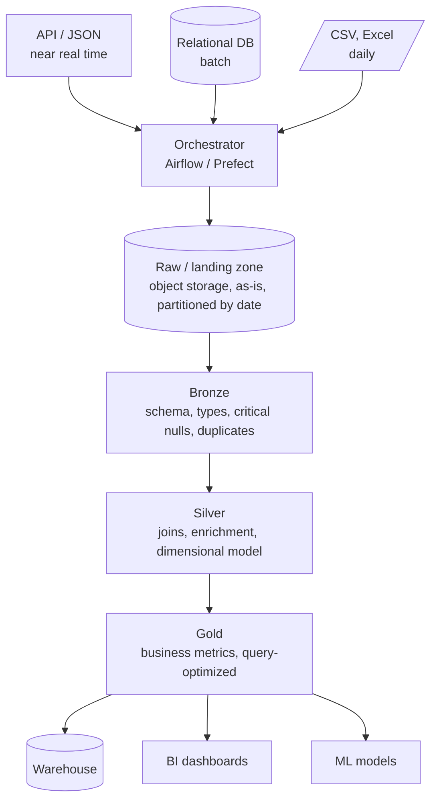

# Design notes

Notes on how I would take this kind of pipeline from a single script to a production data platform, plus a few SQL practices that came up while building it.

## 1. End-to-end design for new sources

When several new sources (a real-time REST/JSON API, a relational database read over ODBC/JDBC in batch, daily CSV/Excel files on SFTP or object storage) have to join an existing data ecosystem, I default to a **medallion architecture**:

Cross-cutting concerns: monitoring and alerting, data-quality rules and SLAs, catalog and lineage, access control and encryption, everything versioned and deployed through CI/CD.

Why this shape:

- **Traceability and replay.** The raw zone keeps the original data, so any layer can be rebuilt after a bug.
- **Fail fast.** Schema and quality checks run at the bronze layer, before bad data reaches analysts.
- **Reuse.** Silver tables serve several gold use cases.
- **Cheap storage.** Object storage costs much less than database storage and needs no schema up front.

A typical rollout: discovery (sources, volumes, latency needs) → infrastructure (storage, orchestrator, environments) → bronze ingestion → silver model → gold aggregates → testing (unit, integration, data quality, performance) → deployment and backfill → handoff (docs, runbooks).

Alternatives I would choose instead when the context calls for them:

- **Lambda / Kappa**: when most sources are streams (events, logs, IoT).
- **Data Vault**: when full auditability of every change and relationship matters most.
- **Data Mesh**: when many domain teams need to own their data products and the organization is mature enough.
- **Classic warehouse + ETL**: when the goal is only traditional reporting.

## 2. Temporary tables vs CTEs

| | Temporary table | CTE (`WITH`) |
|---|---|---|
| Lifetime | the session | a single statement |
| Physical | yes (e.g. `tempdb`) | no; the optimizer inlines or materializes it |
| Indexable | yes | no |
| Recursive | no | yes |
| Best for | intermediate results reused many times, step-by-step debugging of long transformations | readability, one-off intermediate results, hierarchies |

Rule of thumb: start with CTEs for readability. Switch to temp tables when a result is reused many times, needs an index, or a long chain of steps has to be debugged one step at a time. Watch temp-space usage in production.

## 3. Changing a column's data type safely

The syntax is easy (`ALTER COLUMN … TYPE` in PostgreSQL, `ALTER COLUMN` in SQL Server, `MODIFY` in Oracle). The risks are not:

1. **Incompatible conversions** (e.g. `VARCHAR` → `INT` with values like `"N/A"`): add a new typed column, migrate with a guarded cast, review what failed, then swap the columns.
2. **Indexes and constraints**: document them, drop them where the engine requires it, change the type, then recreate them.
3. **Large tables**: a rewrite can lock the table for a long time. Prefer metadata-only changes when the engine supports them; otherwise build a new table, copy in batches, and swap the names in one transaction.
4. **Consumers**: applications and reports may break on the new type, so coordinate the change with them.

## 4. Indexes and partitions

**Indexes** speed up filters, joins and sorts, and unique indexes enforce integrity. They cost disk space and slow writes, and they need maintenance. I index primary and foreign keys and high-cardinality columns that are frequently used in `WHERE`, `JOIN` and `ORDER BY`. I avoid indexing low-cardinality columns and tiny tables.

**Partitions** split a big table by range (usually date), list or hash. They give:

- partition pruning for queries that filter on the partition key;
- instant retention (drop a partition instead of a huge `DELETE`);
- granular maintenance and backups;
- parallel scans;
- hot/cold storage tiers.

I partition when a table is very large, has a natural key (usually a date) that typical queries filter on, and old data is purged regularly. Combining both, with partitions pruned first and then index scans inside each partition, is usually the best of both worlds.
